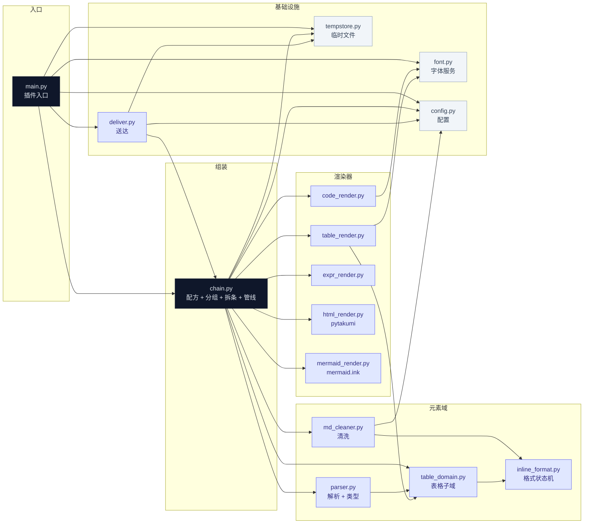

# CLAUDE.md

This file provides guidance to Claude Code (claude.ai/code) when working with code in this repository.

## 项目概述

AstrBot 插件，拦截 QQ 消息中的 markdown **代码块**、**HTML 文档**、**Mermaid 图表**、**表格**和**数学表达式**，渲染为图片/文件后替换到消息链，并清洗剩余文本中的 markdown 格式标记（加粗、斜体、删除线等）。

管道位置：`OnDecoratingResultEvent`（priority=1000），在 RespondStage 之前修改 `result.chain`。

## 常用命令

插件运行在 Docker 容器 `astrbot`（soulter/astrbot）内，容器内路径 `/AstrBot/data/plugins/astrbot_plugin_md_render` 与宿主机本目录 bind mount 同步。**宿主机不再维护 .venv**，所有检查/测试/装包一律 docker exec 进容器执行，一条命令完成：

```bash
# 代码检查
docker exec -w /AstrBot/data/plugins/astrbot_plugin_md_render astrbot ruff check .

# 运行全部测试
docker exec -w /AstrBot/data/plugins/astrbot_plugin_md_render astrbot python3 -m pytest

# 运行单个测试文件/用例
docker exec -w /AstrBot/data/plugins/astrbot_plugin_md_render astrbot python3 -m pytest tests/test_xxx.py
docker exec -w /AstrBot/data/plugins/astrbot_plugin_md_render astrbot python3 -m pytest tests/test_xxx.py::test_func_name -v

# 安装/更新依赖（容器内全局环境，测试框架 pytest/ruff 已预装）
docker exec -w /AstrBot/data/plugins/astrbot_plugin_md_render astrbot python3 -m pip install -r requirements.txt

# 改动生效：重启 astrbot 容器
docker restart astrbot
```

## 环境约束

- **所有 Python 操作一律在 `astrbot` 容器内执行**：用 `docker exec -w /AstrBot/data/plugins/astrbot_plugin_md_render astrbot <命令>`，宿主机不建 .venv、不向宿主机/系统 Python 装包，subagent 同样必须如此
- **容器内即插件运行环境**（Python 3.12 全局环境）：`pip install` 直接作用于容器全局，只安装 requirements.txt 声明的依赖，不随意升降级容器内已装包
- **依赖已在 requirements.txt 声明**：新增依赖先加文件再 install
- **代码改动后需重启容器生效**：`docker restart astrbot`（改配置/装依赖后同理）

## 编码规范

- **无兜底**：错误直接暴露，不静默吞掉
- **日志**：一律 `from astrbot.api import logger`，不用标准库 `logging.getLogger(__name__)`（插件市场审核要求）
- **无死代码、无冗余**：不写用不到的代码，高度复用、解耦
- **Docstring**：中文，Google Style（`"""一句话概述。\n\nArgs:\n    x: ...\nReturns:\n    ...\n"""`）
- **类型注解**：所有函数签名必须有完整类型注解
- **测试**：ruff 零告警 + pytest 覆盖核心逻辑
- **Superpowers 文档**：不提交到 git（已在 `.gitignore` 排除 `docs/superpowers/`）
- **Superpowers spec**：用中文写，写完自审后交出（自查：TBD/占位符、内部矛盾、范围过大、歧义表述）

## 架构

### 入口

`main.py` — AstrBot Star Plugin，类继承 `Star`，`@register` 注册。

### 插件生命周期

```
__init__(context) → initialize() → [事件处理] → terminate()
```

### 事件处理链

```
LLM/Star 生成消息
    │
    ▼
OnDecoratingResultEvent (priority=1000)  ← 本插件
    │  收集所有 Plain 文本，拼接后解析为 Segment 列表
    │  按配置模式将各 Segment 渲染为 Image(png) / File(.md) / Plain
    │  流水线逐条产出：除末条外就绪即发，末条经 result.chain 留尾
    │
    ▼
RespondStage 发送最终 chain
```

### 模块结构



深色 = 深模块（接口小、实现厚）· 中色 = 元素域/渲染器 · 浅色 = 基础设施叶模块。

### 配置与基础设施

配置与基础设施各自独立成模块：
- `render/config.py` — `RenderConfig`/`SegmentConfig`/`CleanConfig` dataclass + `load_config(raw)` 从 AstrBot 配置字典构造
- `render/font.py` — 字体服务：`init_font(data_dir)` / `find_font_spec()` / `get_font(size)`，返回 `FontSpec(path, index)`；候选顺序 `data_dir/fonts/SarasaMonoSC-Regular.ttf`（手动放置，不自动下载）→ 系统 Noto Sans Mono CJK SC（`NotoSansCJK-Regular.ttc` 第 7 个 face）→ 文泉驿等宽（第 1 个 face）→ DejaVu Sans Mono，按字号缓存。ttc 必须带 face，第 0 个是比例字体
- `render/tempstore.py` — 临时文件命名 `build_temp_path(data_dir, prefix, ext)` / 删除 / 刷新 + 后台按 TTL 清扫

### 模块

| 模块 | 职责 |
|------|------|
| `render/parser.py` | markdown-it-py 解析，输出 CodeBlock/HtmlDoc/MermaidBlock/Table/InlineExpr/BlockExpr/Segment/Divider + 元素原文序列化（codeblock/expr 的 to_markdown/to_plain） |
| `render/table_domain.py` | Span/RichCell/Table 模型 + 表格解析/还原（`parse_table`/`table_to_markdown`/`table_to_plain`） |
| `render/inline_format.py` | 行内格式状态机 `FormatState`/`advance`，表格与清洗共用 |
| `render/code_render.py` | pygments → pillow 渲染代码块，返回 PNG bytes |
| `render/table_render.py` | Pillow 手绘表格为 PNG bytes，支持格内加粗/斜体/删除线/行内代码/链接混排 |
| `render/expr_render.py` | pillowlatex 渲染 LaTeX 表达式（行内/块级），返回 PNG bytes |
| `render/html_render.py` | pytakumi（无浏览器）渲染完整 HTML 文档，抽 `<style>` 传 `stylesheets`，注册中文字体 |
| `render/mermaid_render.py` | mermaid.ink 外部服务渲染图表，`httpx.AsyncClient` 异步请求（不占线程池），5s 超时 + 5xx 重试一次，失败抛给上层回退 |
| `render/chain.py` | 配方表 `_ELEMENT_SPECS` + 分组/拆条 + `plan_chain` 提交渲染任务 + `Pipeline` 按序逐条产出（含 15s 单元素渲染超时） |
| `render/md_cleaner.py` | markdown-it-py token 遍历清洗 markdown 格式标记 |
| `render/deliver.py` | 按序发送 + 删临时文件，末条留尾（AstrBot 无关，经 send 回调注入） |
| `render/tempstore.py` | 临时文件命名/删除/刷新 + 后台 TTL 清扫 |
| `render/font.py` | 字体发现（`FontSpec` 含 ttc face index）+ 按字号缓存 |
| `render/config.py` | `RenderConfig`/`SegmentConfig`/`CleanConfig` dataclass + 配置加载 |

### 关键 API

- `StarTools.get_data_dir("astrbot_plugin_md_render")` — 获取插件数据目录，临时文件放 `temp/` 子目录
- `event.get_result().chain` — 获取/修改消息链
- `@filter.on_decorating_result(priority=1000)` — 注册装饰结果事件

### 依赖

`pygments`, `pillow`, `markdown-it-py`, `pillowlatex`, `pytakumi`

`skills/show-me/` 是插件内置技能：AstrBot 扫描 `<plugin>/skills/<name>/SKILL.md`，frontmatter 只读 `description`（`disable-model-invocation` 无效）。同名技能时 `data/skills/` 优先，会遮住插件内置版本。

### 配置

通过 AstrBot 内置配置系统，`_conf_schema.json` 提供一个根级开关和三个嵌套配置块，`load_config` 按 `raw["仅处理模型回复"]` / `raw["渲染"]` / `raw["分段"]` / `raw["清洗"]` 构造：

**根级**：
- 仅处理模型回复：默认关。开启后 `on_decorating_result` 只在 `result.is_model_result()` 时处理，其它插件与内置命令的消息原样放过。无论开关如何，`STREAMING_FINISH` 结果一律跳过：流式阶段已把原文发出，RespondStage 不会再发这条结果，继续渲染会让 `deliver` 重复发送前几条

**渲染**（`raw["渲染"]`）：
- 代码块：不处理 / 渲染图像 / 渲染且保留原文 / 渲染且md文件 / 仅md文件（默认 渲染且md文件）
- 表格：同上五选项（默认 渲染图像）
- 表达式：不处理 / 渲染图像 / 渲染且保留原文（默认 渲染图像）
- Mermaid：不处理 / 渲染图像 / 渲染且保留原文 / 渲染且md文件 / 仅md文件（默认 渲染图像），图片走 mermaid.ink，需联网；md 文件由 QQ 原生渲染
- HTML：不处理 / 渲染图像 / 渲染且保留原文（默认 渲染图像），只处理含 `<!DOCTYPE`/`<html>` 的完整文档
- HTML 宽度（像素）：默认 1000，高度按内容自适应
- 临时文件存活（分钟）：3=默认保留 3 分钟，0=即时删除，-1=永久保留

**分段**（`raw["分段"]`）：
- 分隔线 / 连续换行：不处理 / 切分（默认切分）
- 发送延时：开/关（默认开），切分后多条消息间随机延时 1~3 秒防风控

**清洗**（`raw["清洗"]`）：15 个 bool 开关。加粗/斜体/删除线/行内代码/链接/标题/无序列表/有序列表/引用/图片/分隔线/连续换行默认开（去除格式标记、压缩空行）；代码块/表格/表达式默认关（仅元素以文本保留时生效）。清洗基于 markdown-it-py token 树，颜表情中的 `*` `_` `~` 不会被误杀

### 设计文档

历史设计文档见 `docs/superpowers/`（如存在），注意部分内容可能过时，以当前代码为准。
