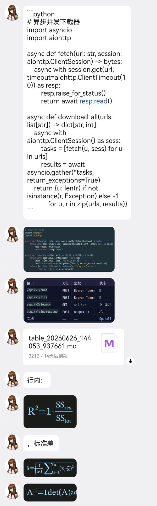
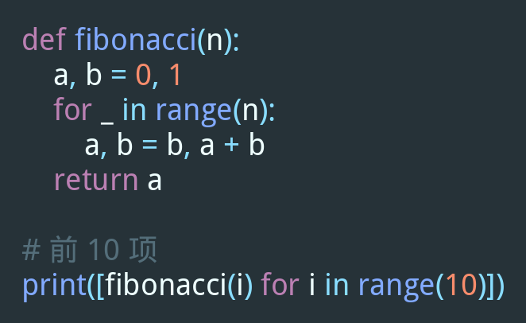
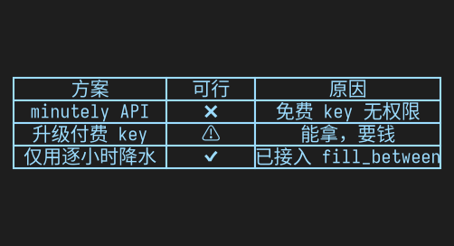
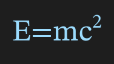
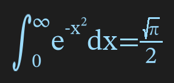

# Markdown 渲染插件

把 QQ 消息中的 Markdown **代码块**、**表格**、**数学表达式**渲染为图片，让机器人回复不再满屏源码。表格支持格内 **加粗**、*斜体*、~~删除线~~、`代码`、[链接](url) 等行内格式。

## ⚠️ 手动安装中文字体（必读）

插件已移除「启动时自动下载并解压字体」的逻辑，需要手动把中文字体放进插件数据目录。未安装时图片中的中文会退化为系统字体；系统也无中文字体时显示为方块（豆腐块）。

**强烈建议 [更纱等宽黑体（Sarasa Mono SC）](https://github.com/be5invis/Sarasa-Gothic)**：中英文严格 2:1 等宽，代码块对齐效果最佳。以下命令在 AstrBot 所在机器执行，**完成后重启 AstrBot 生效**：

```bash
# 1) 下载压缩包（约 68MB；GitHub 直连不稳时默认走镜像，失败换注释里的直连）
wget https://gh-proxy.com/https://github.com/be5invis/Sarasa-Gothic/releases/download/v1.0.27/SarasaMonoSC-TTF-1.0.27.7z
# 镜像失败则直连：wget https://github.com/be5invis/Sarasa-Gothic/releases/download/v1.0.27/SarasaMonoSC-TTF-1.0.27.7z

# 2) 解压出 Regular 字重（约 25MB），只需这一个文件；没有 7z 先装：apt-get install -y p7zip-full
7z e SarasaMonoSC-TTF-1.0.27.7z SarasaMonoSC-Regular.ttf

# 3) 放进插件字体目录（DATA_DIR = AstrBot 数据目录，Docker 镜像默认为 /AstrBot/data）
DATA_DIR=/AstrBot/data
FONT_DIR="$DATA_DIR/plugin_data/astrbot_plugin_md_render/fonts"
mkdir -p "$FONT_DIR"
mv SarasaMonoSC-Regular.ttf "$FONT_DIR/"

# 4) 重启生效（非 Docker 部署：在 AstrBot 管理面板重启/重载插件）
docker restart astrbot
```

也可以使用任意其它中文字体：将 `.ttf` 重命名为 `SarasaMonoSC-Regular.ttf` 放入上述目录即可。

## 效果展示



| 代码块 | 表格（格内格式） |
|--------|------------------|
|  |  |

| 行内表达式 | 块级表达式 |
|-----------|-----------|
|  |  |

## 配置项

| 配置项 | 可选值 | 默认 | 说明 |
|--------|--------|------|------|
| 代码块 | 不处理 / 渲染图像 / 渲染且保留原文 / 渲染且md文件 / 仅md文件 | 渲染且md文件 | `仅md文件` 只发 .md 不渲染 |
| 表格 | 不处理 / 渲染图像 / 渲染且保留原文 / 渲染且md文件 / 仅md文件 | 渲染图像 | `仅md文件` 只发 .md 不渲染 |
| 表达式 | 不处理 / 渲染图像 / 渲染且保留原文 | 渲染图像 | 支持 $...$ 行内和 $$...$$ 块级 |
| 分隔线 | 不处理 / 切分 | 不处理 | `切分` 在分隔线处拆成多条 QQ 消息 |
| 连续换行 | 不处理 / 切分 | 不处理 | `切分` 在空行处拆成多条 QQ 消息 |
| 发送延时 | 开/关 | 开 | 多条消息间随机延时：图片/文件间 1~3 秒，纯文本间 0.3~1 秒防风控 |
| 临时文件存活 | 整数（分钟） | 3 | 0=即时删除，-1=永久保留 |

## 特殊说明

### 发送切分

含代码块/表格/表达式渲染的消息按下述规则拆分发送，保持阅读顺序：

- **行内表达式**（`$...$`）与相邻文字合成一条消息，表达式图片插在文字原位，不单独成条。
- **代码块 / 表格 / 块级表达式**（`$$...$$`）各自独立成条；「渲染且保留原文」下原文与图片分两条发送，互不粘连。
- 内联流被块级元素打断时，块级元素前后的文字段各自携带行内表达式合并成条。
- 空行、分隔线切分照旧生效。纯文本消息保持单条不拆。

### Markdown 格式清洗

插件会在渲染代码块/表格/表达式后，对剩余文本中的 Markdown 格式标记进行清洗。每种格式可独立开关，默认全部开启。

| 格式 | 语法 | 清洗后 |
|------|------|--------|
| 加粗 | `**text**` | `text` |
| 斜体 | `*text*` | `text` |
| 删除线 | `~~text~~` | `text` |
| 行内代码 | `` `text` `` | `text` |
| 链接 | `[text](url)` | `text (url)` |
| 标题 | `# text` | `text` |
| 无序列表 | `- item` | `item` |
| 有序列表 | `1. item` | `item` |
| 引用 | `> text` | `text` |
| 图片 | `` | `alt (url)` |

清洗基于 markdown-it-py 的 CommonMark 语法解析，颜表情如 `(￣▽￣*)` 中的 `*` 不会被误判为斜体。

### 已渲染元素清洗

以下选项控制代码块、表格、表达式在**以文本形式保留**时（即渲染模式设为"不处理"或"渲染且保留原文"）是否去除其 markdown 标记。不影响渲染生成的图片/文件。

| 格式 | 语法 | 清洗后 |
|------|------|--------|
| 代码块 | `` ```py\ncode\n``` `` | `code` |
| 表格 | `\| A \| B \|` + 分隔行 | `A \| B` |
| 表达式 | `$E=mc^2$` / `$$...$$` | `E=mc^2` |

默认全部 **关闭**，与格式标记清洗（默认开启）区分。

