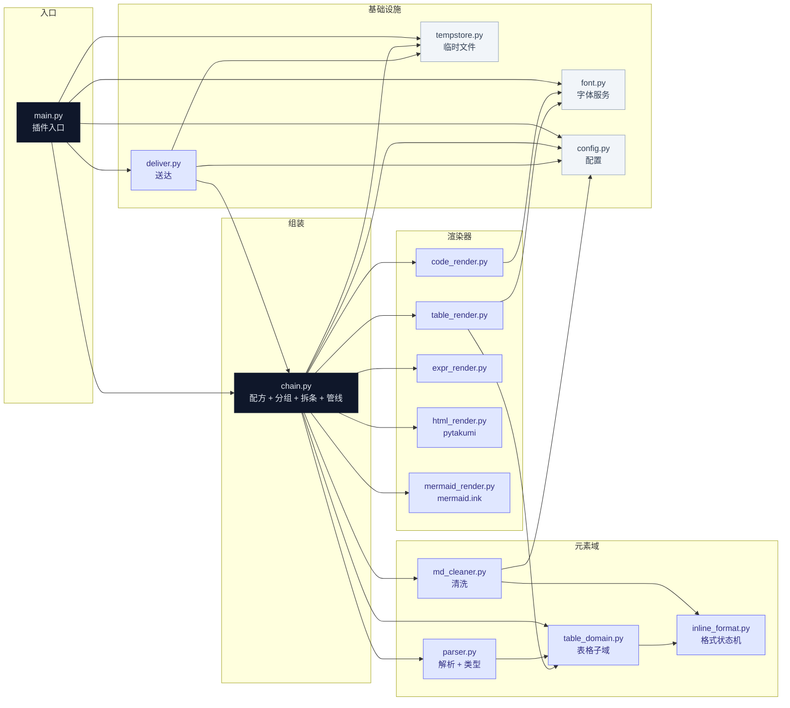

# Markdown 渲染插件

把 QQ 消息中的 Markdown **代码块**、**表格**、**数学表达式**、**HTML 文档**、**Mermaid 图表**渲染为图片，让机器人回复不再满屏源码。表格支持格内 **加粗**、*斜体*、~~删除线~~、`代码`、[链接](url) 等行内格式。

## 效果展示

| 代码块 | 表格（格内格式） | 行内表达式 | 块级表达式 |
|--------|------------------|-----------|-----------|
|  |  |  |  |

> **注意**：
> - 关闭 AstrBot「配置文件 -> 扩展功能 -> 启用分段回复」，否则官方会再次拆分本插件已分段的消息。
> - 若开启了「流式输出」，请把「不支持流式回复的平台」设为「关闭流式回复」。选默认的「实时分段回复」时，原文已按标点拆成多条纯文本先行发完，插件不会再渲染这些内容。

## 字体

不需要手动安装：插件按顺序自动发现可用字体，优先等宽且含中文的。

| 顺序 | 字体 | 来源 |
|------|------|------|
| 1 | 手动放置的字体 | `<数据目录>/plugin_data/astrbot_plugin_md_render/fonts/SarasaMonoSC-Regular.ttf` |
| 2 | Noto Sans Mono CJK SC | 系统 `NotoSansCJK-Regular.ttc` 的第 7 个 face（AstrBot 官方镜像自带 `fonts-noto-cjk`） |
| 3 | WenQuanYi Micro Hei Mono | 系统 `wqy-microhei.ttc` 的第 1 个 face（部分镜像自带） |
| 4 | DejaVu Sans Mono | 无中文字形，仅作保底（中文显示为豆腐块） |

ttc 集合必须指定 face：第 0 个 face 是比例字体，按路径直接取会让代码列对齐歪掉。

想要更好的代码观感，可以手动放 [更纱等宽黑体（Sarasa Mono SC）](https://github.com/be5invis/Sarasa-Gothic)：中英文严格 2:1 等宽，优先于系统字体。以下命令在 AstrBot 所在机器执行，**完成后重启 AstrBot 生效**：

```bash
# 1) 下载压缩包（约 68MB；GitHub 直连不稳时默认走镜像，失败换注释里的直连）
wget https://gh-proxy.com/https://github.com/be5invis/Sarasa-Gothic/releases/download/v1.0.27/SarasaMonoSC-TTF-1.0.27.7z
# 镜像失败则直连：wget https://github.com/be5invis/Sarasa-Gothic/releases/download/v1.0.27/SarasaMonoSC-TTF-1.0.27.7z

# 2) 解压出 Regular 字重（约 25MB），只需这一个文件；没有 7z 先装：apt-get install -y p7zip-full
7z e SarasaMonoSC-TTF-1.0.27.7z SarasaMonoSC-Regular.ttf

# 3) 放进插件字体目录（DATA_DIR = AstrBot 数据目录，Docker 镜像默认为 /AstrBot/data）
DATA_DIR=/AstrBot/data
FONT_DIR="$DATA_DIR/plugin_data/astrbot_plugin_md_render/fonts"
mkdir -p "$FONT_DIR"
mv SarasaMonoSC-Regular.ttf "$FONT_DIR/"

# 4) 重启生效（非 Docker 部署：在 AstrBot 管理面板重启/重载插件）
docker restart astrbot
```

任意其它中文字体也可以：重命名为 `SarasaMonoSC-Regular.ttf` 放入该目录即可。插件不会在运行时下载或解压任何字体。

HTML 文档渲染走另一条字体路径：优先系统自带的 `Noto Sans CJK SC`（按字体名注册），没有则用文泉驿，两者都缺时才回退到上表第 1 项。

## 配置

配置面板最上层是一个独立开关，其余分三大块，与 AstrBot 配置面板一致。

### 根级

| 配置项 | 默认 | 说明 |
|--------|------|------|
| 仅处理模型回复 | 关 | 开启后只渲染 LLM / Agent 回复；其它插件与内置命令的普通消息原样放过 |

### 渲染

| 配置项 | 可选值 | 默认 |
|--------|--------|------|
| 代码块 | 不处理 / 渲染图像 / 渲染且保留原文 / 渲染且md文件 / 仅md文件 | 渲染且md文件 |
| 表格 | 不处理 / 渲染图像 / 渲染且保留原文 / 渲染且md文件 / 仅md文件 | 渲染图像 |
| 表达式 | 不处理 / 渲染图像 / 渲染且保留原文 | 渲染图像 |
| Mermaid | 不处理 / 渲染图像 / 渲染且保留原文 / 渲染且md文件 / 仅md文件 | 渲染图像 |
| HTML | 不处理 / 渲染图像 / 渲染且保留原文 | 渲染图像 |
| HTML 宽度 | 整数（像素） | 1000 |
| 临时文件存活 | 整数（分钟） | 3 |

### 分段

| 配置项 | 可选值 | 默认 |
|--------|--------|------|
| 分隔线 | 不处理 / 切分 | 切分 |
| 连续换行 | 不处理 / 切分 | 切分 |
| 发送延时 | 开/关 | 开 |

### 清洗

| 配置项 | 默认 |
|--------|------|
| 加粗 | 开 |
| 斜体 | 开 |
| 删除线 | 开 |
| 行内代码 | 开 |
| 链接 | 开 |
| 标题 | 开 |
| 无序列表 | 开 |
| 有序列表 | 开 |
| 引用 | 开 |
| 图片 | 开 |
| 分隔线 | 开 |
| 连续换行 | 开 |
| 代码块 | 关 |
| 表格 | 关 |
| 表达式 | 关 |

### 配置说明

- 渲染里的 `仅md文件`：只发 .md 文件，不渲染图片。
- 表达式支持 `$...$` 行内和 `$$...$$` 块级。
- Mermaid 走 [mermaid.ink](https://mermaid.ink) 外部服务，**需要联网**；超时（5 秒）或服务端 5xx 时重试一次，仍失败则回退为源码文本。图的源码会发送给该服务。md 文件模式不走该服务：QQ 客户端能原生渲染 md 里的 mermaid/表格/公式/代码块，`仅md文件` 是零外网、零依赖的路线。
- HTML 只处理**完整文档**（含 `<!DOCTYPE` 或 `<html>`）；HTML 片段仍按普通代码块渲染，避免把「讨论 HTML 语法」变成一张网页图。渲染不走浏览器，为 pytakumi（Rust 布局引擎），支持常用 CSS（flex/grid/表格/圆角），不执行 JS、不加载外链图片。
- 图渲染失败但配置了 md 文件（`渲染且md文件`）时，仍会产出 `.md`，不会静默丢文件。
- HTML 宽度：仅影响 HTML 文档渲染，高度按内容自适应。
- 临时文件存活：分钟；`0`=发送完成后立即删除，`-1`=永久保留。
- 发送延时：切分后多条消息间随机延时防风控，图片/文件间 1~3 秒，纯文本间 0.3~1 秒。
- 清洗里的「分隔线」「连续换行」与分段的同名项不同：这里指清洗文本中的 `---` 标记、把连续空行压为单个换行。
- 清洗开关分两组：以上前 12 项默认开，作用于渲染后剩余的纯文本；**代码块 / 表格 / 表达式**默认关，只在以文本形式保留元素时生效（见下）。HTML 文档与 Mermaid 图表以文本保留时，沿用「代码块」开关。

#### 格式标记清洗效果

| 格式 | 语法 | 清洗后 |
|------|------|--------|
| 加粗 | `**text**` | `text` |
| 斜体 | `*text*` | `text` |
| 删除线 | `~~text~~` | `text` |
| 行内代码 | `` `text` `` | `text` |
| 链接 | `[text](url)` | `text (url)` |
| 标题 | `# text` | `text` |
| 无序列表 | `- item` | `item` |
| 有序列表 | `1. item` | `item` |
| 引用 | `> text` | `text` |
| 图片 | `` | `alt (url)` |

清洗基于 markdown-it-py 的 CommonMark 语法解析，颜表情如 `(￣▽￣*)` 中的 `*` 不会被误判为斜体。

#### 已渲染元素清洗效果

以下选项控制代码块、表格、表达式在**以文本形式保留**时（即渲染模式设为"不处理"或"渲染且保留原文"）是否去除其 markdown 标记。不影响渲染生成的图片/文件。

| 格式 | 语法 | 清洗后 |
|------|------|--------|
| 代码块 | `` ```py\ncode\n``` `` | `code` |
| 表格 | `\| A \| B \|` + 分隔行 | `A \| B` |
| 表达式 | `$E=mc^2$` / `$$...$$` | `E=mc^2` |

## 发送切分

含代码块/表格/表达式/HTML/Mermaid 渲染的消息按下述规则拆分发送，保持阅读顺序：

- **行内表达式**（`$...$`）与相邻文字合成一条消息，表达式图片插在文字原位，不单独成条。
- **代码块 / 表格 / 块级表达式**（`$$...$$`）/ **HTML 文档** / **Mermaid 图表** 各自独立成条；「渲染且保留原文」下原文与图片分两条发送，互不粘连。
- 内联流被块级元素打断时，块级元素前后的文字段各自携带行内表达式合并成条。
- 空行、分隔线切分照旧生效。纯文本消息保持单条不拆。

## 聊天效果


## 架构



深色 = 深模块（接口小、实现厚）· 中色 = 元素域/渲染器 · 浅色 = 基础设施叶模块。
