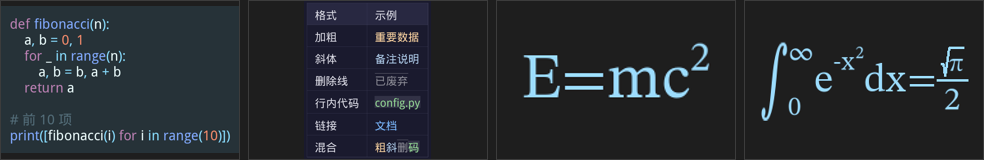
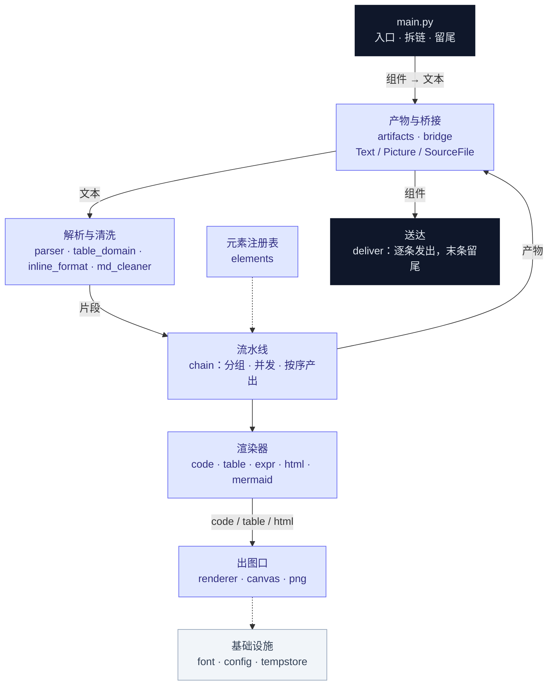

# Markdown 渲染

代码块、表格、表达式、HTML、Mermaid 在聊天里直接变成图。渲染在本机完成，不用浏览器，不用 Node。

小、轻、快。先给图，图不够再给源码文件。



从左到右：代码块、表格、行内表达式、块级表达式。

## 启用

在 AstrBot 插件市场搜索「Markdown 渲染」安装；或把仓库克隆到 AstrBot 的 `data/plugins/` 目录，重启 AstrBot。

装完再改两个 AstrBot 设置：

1. 关闭「配置文件 → 扩展功能 → 启用分段回复」。
2. 开启流式输出时，把「不支持流式回复的平台」设为「关闭流式回复」。

## 默认行为

不改配置时，块级内容按这张表处理：

| 内容 | 默认模式 | 收到什么 |
|------|----------|----------|
| 代码块 | 渲染且md文件 | 一张图，加一个 `.md` 源码文件 |
| 表格 | 渲染图像 | 一张图；格内的 `$...$` 也画成公式 |
| 表达式 | 渲染图像 | 一张图 |
| Mermaid | 渲染图像 | 一张图 |
| HTML 文档 | 渲染图像 | 一张图 |

<table>
  <tr>
    <td valign="top">
      代码块、表格、块级表达式、HTML 文档、Mermaid 图表各自独立成条。<br><br>
      行内表达式与相邻文字合成一条，图片插在文字原位。<br><br>
      空行与 <code>---</code> 按分段配置切分，纯文本保持单条。
    </td>
    <td width="260"></td>
  </tr>
</table>

## 配置

面板最上层是「仅处理模型回复」，其余分三块。

### 根级

| 配置项 | 默认 | 说明 |
|--------|------|------|
| 仅处理模型回复 | 关 | 只渲染 LLM 与 Agent 的回复，其它插件与内置命令的消息原样发出 |

### 渲染

| 配置项 | 默认 | 可选值 |
|--------|------|--------|
| 代码块 | 渲染且md文件 | 不处理 / 渲染图像 / 渲染且保留原文 / 渲染且md文件 / 仅md文件 |
| 表格 | 渲染图像 | 不处理 / 渲染图像 / 渲染且保留原文 / 渲染且md文件 / 仅md文件 |
| 表达式 | 渲染图像 | 不处理 / 渲染图像 / 渲染且保留原文 |
| Mermaid | 渲染图像 | 不处理 / 渲染图像 / 渲染且保留原文 / 渲染且md文件 / 仅md文件 |
| HTML | 渲染图像 | 不处理 / 渲染图像 / 渲染且保留原文 |
| HTML 宽度 | 1000 | 整数，单位为像素 |
| 临时文件存活 | 3 | 整数，单位为分钟 |

- `渲染图像` 只出图。
- `渲染且保留原文` 出图，并把 markdown 原文作为文本发出。
- `渲染且md文件` 出图，并附一个 `.md` 源码文件。图渲染失败时仍出 `.md`。
- `仅md文件` 只发 `.md` 文件，不出图，不走外网。QQ 客户端能原生渲染 .md 里的代码、表格、公式、Mermaid。
- 表达式支持 `$...$` 行内与 `$$...$$` 块级。块级公式的 `$$` 必须独占行首，或同一行内成对出现；行内代码与代码围栏里的 `$` 不当作公式。
- 公式由 Typst 排版（`tylax` 负责 LaTeX→Typst 转换），支持 `aligned`/矩阵/公式内中文；转换不了的命令回退为原文，不再猜。
- Mermaid 出图走 [mermaid.ink](https://mermaid.ink)，需要联网，图的源码会发送给该服务。
- HTML 只处理完整文档，判定条件是含 `<!DOCTYPE` 或 `<html>`。HTML 片段按代码块处理。
- HTML 宽度只影响 HTML 文档，高度按内容自适应。
- 临时文件存活设 `0` 时发送完成即删除，设 `-1` 时永久保留。

### 分段

| 配置项 | 默认 | 可选值 |
|--------|------|--------|
| 分隔线 | 切分 | 不处理 / 切分 |
| 连续换行 | 切分 | 不处理 / 切分 |
| 发送延时 | 开 | 开 / 关 |

- 分隔线指 `---`，连续换行指空行。
- 发送延时在多条消息之间随机等待，图片与文件之间 1~3 秒，纯文本之间 0.3~1 秒。
- 这里的「分隔线」「连续换行」控制切分位置，与清洗里的同名项不是同一件事。

### 清洗

| 默认开 | 默认关 |
|--------|--------|
| 加粗、斜体、删除线、行内代码、链接、标题、无序列表、有序列表、引用、图片、分隔线、连续换行 | 代码块、表格、表达式 |

- 「默认开」的部分作用于渲染之后剩下的纯文本。
- 「默认关」的部分只在元素以文本形式保留时生效，即该元素模式为 `不处理` 或 `渲染且保留原文`。
- HTML 文档与 Mermaid 图表以文本形式保留时，沿用「代码块」这一项。

| 格式 | 语法 | 清洗后 |
|------|------|--------|
| 加粗 | `**text**` | `text` |
| 斜体 | `*text*` | `text` |
| 删除线 | `~~text~~` | `text` |
| 行内代码 | `` `text` `` | `text` |
| 链接 | `[text](url)` | `text (url)` |
| 标题 | `# text` | `text` |
| 无序列表 | `- item` | `item` |
| 有序列表 | `1. item` | `item` |
| 引用 | `> text` | `text` |
| 图片 | `` | `alt (url)` |

| 元素 | 语法 | 清洗后 |
|------|------|--------|
| 代码块 | ` ```py\ncode\n``` ` | `code` |
| 表格 | 表格原文 | 竖线保留，去掉表头分隔行 |
| 表达式 | `$E=mc^2$` / `$$...$$` | `E=mc^2` |

清洗基于 markdown-it-py 的 CommonMark 解析，颜表情里的 `*` 不会被当作斜体。

## 常见问题

**回复被拆成好几条，或者内容没有渲染**
AstrBot 的「启用分段回复」开着。开启流式输出时，把「不支持流式回复的平台」设为「关闭流式回复」。

**Mermaid 显示成源码**
mermaid.ink 连不上，插件回退为源码。把 Mermaid 的模式改成 `仅md文件` 可以完全不走外网。

**中文显示成方块**
字体发现全部落空。装一个中文字体，见 [docs/fonts.md](docs/fonts.md)。

**HTML 代码块没有变成网页图**
只渲染完整文档。片段按普通代码块处理。

**代码块为什么多收到一个文件**
默认模式是 `渲染且md文件`，图看不清时可以点开源码。不想要就改成 `渲染图像`。

**临时文件在哪**
数据目录下的 `temp/` 子目录，默认 3 分钟后清理，可改「临时文件存活」。

## 字体

插件自动发现系统字体，AstrBot 官方镜像自带 Noto Sans CJK，通常不需要配置。想要更整齐的代码观感，可以装 Sarasa Mono SC，见 [docs/fonts.md](docs/fonts.md)。

## 架构

实线是数据流，虚线是依赖。



深色为入口与出口，中色为元素域与渲染器，浅色为基础设施。图只画到职责层：一个节点可能对应多个文件，逐文件职责看代码。
